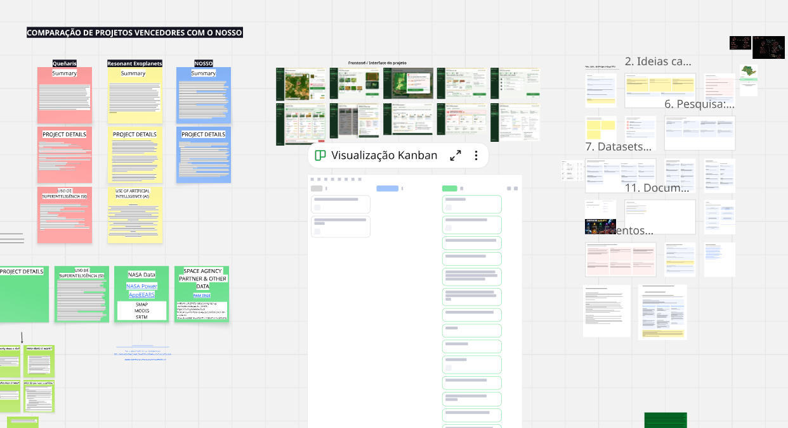

# INTRODUCTION

RollCrop is a free decision-support tool for farmers in São Paulo state. For each field it compares the current crop rotation with 2 alternatives using NASA Earth observations, local soil, crop traits and the farmer's priorities, and warns before planting when a crop is likely to fail. It supports the farmer and the agronomist; it does not replace them.

# DEVELOPMENT

As part of our submission to the 2026 Nasa Space Apps Challenge hackathon, we had **48 hours** to develop a solution for the theme "Field Shift — Adapting Farms with NASA Data". We chose the theme because agriculture in Brazil is a massive industry, greatly affected by unpredictable natural phenomena, so a solution for this problem felt close to home and real.

First, we gathered in **Centro Tecnológico de Sorocaba** to seek inspiration and brainstorm an idea, which quite frankly culiminated in hours of headache... we didn't hit anything particularly attractive. 

Since the hunt for an idea was ongoing, we decided that it was best to start implementing something in the meantime, at which point we started assembling our **Miro** board and I started working on the backend for the project, which interacts with NASA APIs such as **NASA POWER** for climate measurements, and started looking into downloading some dataset regional samples from **NASA AppEEARS**.

During late hours we finally locked into our decision-support tool idea, for which the concept started emerging.

# IMPLEMENTATION

RollCrop is split into a **Vue 3 + Vite** frontend and a **FastAPI** backend, both deployed on **Vercel**.

The backend gathers the data and its provenance: daily climate series from **NASA POWER**, soil profiles from **SoilGrids**, terrain slope from **NASA SRTM**, and satellite statistics (NDVI, soil moisture, surface temperature) from **MODIS** and **SMAP** via AppEEARS. With this, it calculates how often frost and white mold events happened in the past 10 years and recommends planting windows for corn and soybean. Each response states where its data came from (`live`, `cache` or an offline `mock` slice), so the demo keeps working even without network access.

The frontend lets the farmer draw their field on a satellite map (with NASA GIBS layers), pick their crops, answer a few soil questions and rank their priorities. It then compares the current rotation against two alternatives from a São Paulo crop catalog, rating each one on drought, frost, erosion and soil cover, and estimates the money at risk using public data from **IBGE** and **CONAB**. Every value shows its source, and the app never presents past records as a forecast.

# RELEVANCE

Agriculture is one of Brazil's largest industries, and a single dry autumn or early frost can wipe out a season's income. RollCrop turns NASA's freely available Earth observation data into answers a farmer can actually act on: *which crop, when to plant, and what's at risk*, without requiring any technical knowledge.

For me, this project was an exercise in working under pressure with a large team, integrating multiple scientific data sources into a single API, and being honest about data: clearly separating measurements, estimates and sample values instead of overselling what the tool knows.

